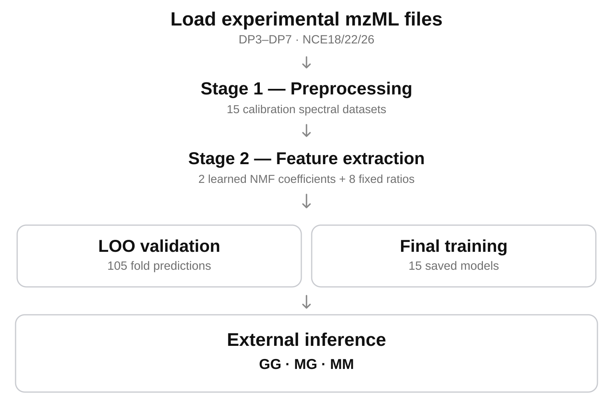

# Alginate HCD-MS/MS composition prediction

Python implementation for estimating the NMR-calibrated mannuronic acid (M) fraction of alginate oligosaccharides (DP3–DP7) from HCD-MS/MS spectra. Each DP × normalized collision energy (NCE 18, 22, or 26) model combines **two learned nonnegative matrix factorization (NMF) coefficients**, **eight fixed fragment-ion intensity ratios**, and **Ridge regression**.

The DP-specific preprocessing parameters, the eight fixed ratio identities, and the model settings are defined in [`configs/models.json`](configs/models.json). Ratio identities are shared across the three NCE settings within each DP; DP3, DP5, and DP7 use `log1p`-transformed ratios, while DP4 and DP6 use raw ratios.

## Workflow



The workflow covers **15 calibration datasets**, **105 composition-held-out LOO predictions**, **15 final models**, and external GG-, MG-, and MM-rich sample inference using **DP3/DP4 NCE26 models only**.

> **Code-release status:** The complete publication pipeline is undergoing local experimental-data verification and has not yet been merged into this repository's `main` branch. The commands below describe that pipeline and will become runnable here when the verified source is published.

## Installation

Python 3.10 or newer is required.

```bash
git clone https://github.com/whr812756608/Alginate.git
cd Alginate

python3 -m venv .venv
source .venv/bin/activate
python -m pip install -e '.[mzml]'
```

## Input data

Raw HCD-MS/MS datasets are referenced under **MassIVE accession MSV000103648**.

Each DP has seven nominal calibration compositions (M0, M20, M40, M50, M60, M80, M100). Their DP-specific NMR-calibrated target values are specified in `configs/models.json`.

Place the calibration mzML files in one input directory, using the naming pattern:

```text
Raw_F{dp}_M{m}G{100-m}.mzML
```

where `dp` is 3–7 and `m` is 0, 20, 40, 50, 60, 80, or 100.

For external inference, the same directory must also contain:

```text
AlgG_LowDPMix_1_051625.mzML
AlgMG_LowDPMix_1_051625.mzML
AlgM_LowDPMix_1_051625.mzML
```

## Run the pipeline

From the repository root, run the full calibration and external-inference workflow:

```bash
python scripts/run_pipeline.py --data-dir /path/to/mzML_directory
```

To reuse existing preprocessed calibration spectra:

```bash
python scripts/run_pipeline.py \
  --data-dir /path/to/mzML_directory \
  --reuse-preprocessed
```

To run calibration evaluation and final-model training without external files, add `--skip-external`.

The same pipeline can be executed step by step:

```bash
python scripts/run_preprocessing.py --data-dir /path/to/mzML_directory --dp all --nce all --out-dir outputs/preprocessed
python scripts/run_features.py --input-dir outputs/preprocessed --out-dir outputs/features
python scripts/run_loo.py --input-dir outputs/preprocessed --out-dir outputs/loo
python scripts/train_final_models.py --input-dir outputs/preprocessed --out-dir outputs/models
python scripts/predict_external.py --data-dir /path/to/mzML_directory --model-dir outputs/models --out-csv outputs/external_dp3_dp4_nce26.csv
```

## Outputs

| Output | Description |
| --- | --- |
| `outputs/preprocessed/` | Fifteen preprocessed calibration spectral datasets |
| `outputs/features/` | Ten-feature matrices: two NMF coefficients and eight fixed ratios |
| `outputs/loo/loo_folds.csv` | 105 composition-level LOO predictions |
| `outputs/loo/loo_by_dp_nce.csv` | LOO MAE reported separately for each DP and NCE |
| `outputs/models/` | Fifteen saved final models and model manifest |
| `outputs/external_dp3_dp4_nce26.csv` | Six predictions: GG, MG, MM for DP3 and DP4 at NCE26 |

## Validation and interpretation

LOO holds out **all spectra from one calibration composition** at a time. NMF and Ridge are fitted using the six remaining groups, and the held-out composition is evaluated without refitting. Fixed fragment-ion ratio identities remain the same across folds. The full-calibration feature export is separate from the fold-specific fitting used for LOO.

The fixed ratios and model settings were developed using the calibration compositions. Accordingly, retrospective LOO is **not an independent, selection-unbiased estimate** of performance. External GG/MG/MM samples have **DP-unresolved bulk NMR references**, not independently measured DP3- or DP4-specific ground truth.

## Citation

A manuscript citation and tagged software release will be added when available.
