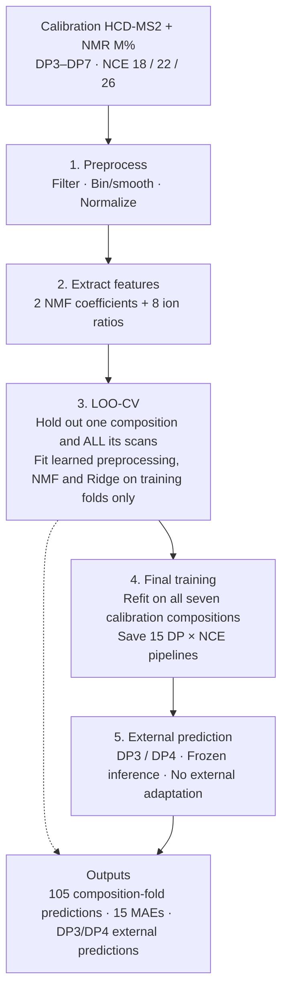

# Alginate HCD-MS2 — NMR-calibrated M/G composition prediction

**Publication-code reconstruction in progress (17 November 2026).** This is the clean repository structure agreed for the manuscript. The exact scientific implementations are being consolidated from the research source and **the five-stage numerical pipeline is not yet verified or runnable for publication predictions**. Do not treat the selected-model reference table as the output of this reconstructed package.

## Scientific workflow

Our method predicts the mannuronic-acid fraction (M%) of alginate oligosaccharide (AOS) mixtures from HCD-MS/MS spectra for DP3–DP7, at normalized collision energies (NCE) 18, 22 and 26. Each model uses **two nonnegative NMF component coefficients (K2), eight selected diagnostic ion-intensity ratios (K8), and Ridge regression**. The term **NMF (K=2)** is used for the common feature-extraction stage; the chosen coefficient extraction procedures are specified in `configs/models.json` so that the actual numeric method can be reproduced.



**Validation detail:** Each DP × NCE is evaluated with seven composition-grouped leave-one-out (LOO) folds. One nominal calibration composition and all associated scans are excluded per fold. Any learned preprocessing, NMF decomposition, feature scaling, ratio selection, and regression must be fitted within the training portion only. Fixed reference components must be constructed without the held-out composition. **Final training** is a *separate* refit on all seven compositions after LOO; the external step only applies the saved fitted pipeline.

## Code map for reviewers

| Stage | Library | Purpose |
| --- | --- | --- |
| 1 · Preprocess | `preprocessing.py` | Read/validate spectra; scan selection, mass grid, smoothing, normalization |
| 2 · Extract K2 + K8 | `nmf.py`, `ion_ratios.py`, `features.py` | Extract two NMF coefficients and eight ratios |
| 3 · Evaluate with LOO-CV | `validation.py` | Hold out all scans from each calibration composition |
| 4 · Train final models | `modeling.py`, `pipeline.py` | Fit DP-specific Ridge pipelines and save 15 models |
| 5 · Predict external | `external.py` | Apply frozen DP3/DP4 models to GG/MG/MM samples |
| Reporting | `reporting.py` | Model- and fold-level reports and figure inputs |

Single configuration registry: **`configs/models.json`**. One root README; no separate DP README or discarded optimization sweeps.

## Models carried forward from research

**Reported historical selected-recipe LOO MAE, in M percentage points (pp). These are retrospective and not a new independent replication.**

| DP | NMF coefficients | Smoothing (Da) | Normalization | γ | Ridge α | NCE18 | NCE22 | NCE26 | Mean |
| --- | --- | ---: | --- | ---: | ---: | ---: | ---: | ---: | ---: |
| DP3 | K2 | 1.5 | ORIGINAL7 λ1 | 4 | 0.03 | 1.397 | 0.935 | 1.185 | 1.172 |
| DP4 | K2 | 0.5 | GALL λ1 | 1 | 0.03 | 1.446 | 1.251 | 1.032 | 1.243 |
| DP5 | K2 (raw) | 1.5 | EQ5 λ1 | 4 | 1 | 3.475 | 2.511 | 2.207 | 2.731 |
| DP6* | K2 | 0 | EQ5 λ0.5 | 0.25 | 1 | 4.589 | 2.554 | 3.733 | 3.625 |
| DP7* | K2 | 0 | Global λ0 | 0.25 | 1 | 3.913 | 3.335 | 2.920 | 3.389 |

*DP6 and DP7 remain provisional in the latest private research documentation. Exact DP5–DP7 K8 choices are training-fold dependent, rather than a verified single frozen ratio list.*

## Installation and verification status

```bash
python -m pip install -e '.[test]'
python -m pytest
```

These commands exercise the **repository configuration and grouped-LOO software tests only**, not a scientific rerun.

The following are the **planned** public interfaces; they presently stop with an explicit message rather than silently substituting unverified scientific computations:

```bash
python scripts/reproduce_loo.py --dp all --nce all
python scripts/train_final_models.py --dp all --nce all
python scripts/predict_external.py --dp 3 4 --nce all
python scripts/reproduce_figures.py
```

## Before declaring this release reproducible

1. Consolidate verified raw mzML scan selection, mass gridding, smoothing and each DP-specific normalization from the selected source scripts.
2. Consolidate the original NMF coefficient extraction, frozen K8 ratio identities (DP3/DP4), and *training-only* ratio discovery (DP5–DP7). Preserve raw coefficients and γ treatment.
3. Integrate these components into the common fit/transform pipeline and check there is no LOO fold leakage.
4. Reproduce **all 105 held-out composition results** and the **15 DP × NCE** summary from original raw data, and then train the 15 final models.
5. Verify external predictions using frozen final DP3/DP4 models. External GG/MG/MM NMR references (12%, 51%, 82%) are **bulk** values, not DP-resolved composition ground truth.
6. Agree on an explicit open-source license, code authorship/citation metadata, and data redistribution terms before a tagged manuscript release.

The previously public V66–V70 package has been preserved in Git history and in the backup branch `archive/pre-publication-2026-11-17`, rather than carried forward into this publication-oriented source tree. The private exploratory repository is kept separate and is not linked as a reproducibility prerequisite for a future public release.

**Data availability:** The prior repository cites MassIVE accession `MSV000103648`. Confirm accessible mzML files, filenames and metadata against that accession before claiming raw-data reproduction.

## Scientific interpretation

Seven-fold LOO holds out complete calibration compositions but does **not** correct for retrospectively choosing these methods using those same seven compositions. These results should not be described as independent nested model-selection validation. For external AOS, comparisons against bulk NMR should be described as descriptive agreement with bulk composition, **not** as DP-specific prediction MAE.
